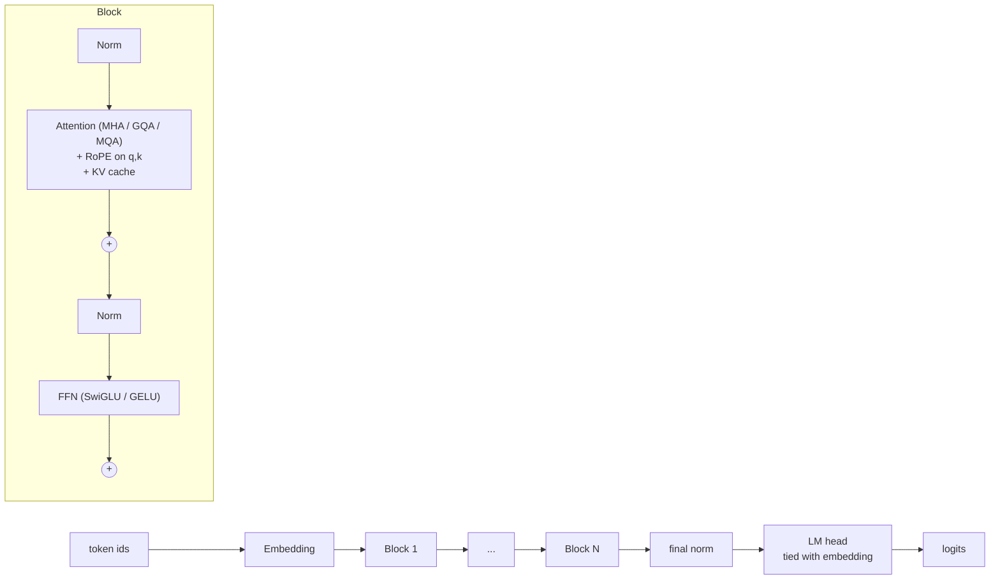

# Oglodon

**Build. Train. Understand. Verify.**

> **`oglodon verify` checks that *any* causal language model is behaving correctly** (Hugging Face, your own
> PyTorch module, or Oglodon) without a reference implementation: causality, padding, batching, KV cache,
> numerics and gradients. See [Verify any model](#verify-any-model).

## Try it in two minutes

```bash
pip install oglodon-transformer                       # until it is published: pip install -e ".[dev]" from a checkout
oglodon train my_texts/ --out run1 --steps 500        # tokenizer + training + checkpoint, from your own .txt/.md files
oglodon generate run1 --prompt "Once upon a time" --seed 1
oglodon eval run1 --text my_texts/some_file.txt       # perplexity next to the uniform-guess baseline
```

No Python code needed. A model trained for minutes learns your text's vocabulary and local structure, not fluent
language; the report (`run1/training_report.json`) shows honestly where it stands. Everything is documented in
[docs/](docs/index.md): [getting started](docs/getting-started.md), [command reference](docs/cli.md),
[training](docs/training.md), [troubleshooting](docs/troubleshooting.md).

Oglodon is a modular PyTorch toolkit for building, training, inspecting and validating modern Transformer
architectures from scratch. It implements a decoder-only (GPT-style) Transformer with RoPE, RMSNorm,
SwiGLU, grouped-query attention and a KV cache, and ships the tooling around it: a trainer, checkpoints,
attention inspection, architecture benchmarks and a model validator that actually runs correctness checks.

It started as a notebook (`notebooks/MiniGPT_Solver_run.ipynb`, a 0.73M-parameter model that learns
addition, sorting and reversal) and was refactored into a library.

> Oglodon is an educational / research-scale toolkit. It is **not** production-ready, is not tuned for large
> models, and is not competitive with large-scale frameworks.

## Architecture



| Component | Options |
|---|---|
| Attention | MHA, GQA, MQA (`num_kv_heads`) |
| Positions | RoPE, or learned absolute embeddings (`use_rope`) |
| Normalisation | RMSNorm or LayerNorm (`use_rmsnorm`) |
| Feed-forward | SwiGLU or GELU MLP (`use_swiglu`) |
| Generation | greedy, temperature, top-k, top-p, EOS, seeded `torch.Generator`, KV cache, left-padded batches |
| Checkpoints | `safetensors` weights + JSON config (+ tokenizer), no pickle for models |

See [docs/architecture.md](docs/architecture.md) for the data flow and for how each notebook component maps to the package.

## Installation

```bash
pip install oglodon-transformer          # intended name, see note below
pip install "oglodon-transformer[viz]"   # + matplotlib for attention plots
pip install "oglodon-transformer[hf]"    # + transformers for Hugging Face tokenizers
pip install "oglodon-transformer[yaml]"  # + PyYAML for YAML configs in the `oglodon` CLI (JSON works without it)
```

> **Not yet published.** Before the first release, check that the name `oglodon-transformer` is free on PyPI
> ([docs/publishing.md](docs/publishing.md)). Until then install from source:

```bash
git clone <your repo url> && cd Oglodon
pip install -e ".[dev]"
```

Requires Python 3.11+ and PyTorch. Runs on CPU; uses CUDA only if you place the model/trainer on it
(`Trainer(device=...)` defaults to CUDA when available, otherwise CPU).

## Quick start (Python)

```python
import torch
from oglodon import Oglodon, OglodonConfig

config = OglodonConfig(
    vocab_size=32000,
    hidden_size=256,
    num_layers=6,
    num_heads=8,
    num_kv_heads=2,
    max_seq_len=512,
    dropout=0.0,
    use_rope=True,
    use_rmsnorm=True,
    use_swiglu=True,
)
model = Oglodon(config)

input_ids = torch.randint(0, config.vocab_size, (2, 128))
logits = model(input_ids)  # (batch, seq, vocab)
print(logits.shape)  # torch.Size([2, 128, 32000])

out = model.generate(
    input_ids[:, :16],
    max_new_tokens=20,
    temperature=0.8,
    top_k=50,
    top_p=0.95,
    generator=torch.Generator().manual_seed(0),
)
```

## Configuration

`OglodonConfig` validates everything on construction and raises `ValueError` with a specific message
(`hidden_size` divisible by `num_heads`, `num_heads` divisible by `num_kv_heads`, positive sizes,
even head dimension for RoPE, `dropout` in `[0, 1)`, special-token ids inside the vocabulary).

```python
OglodonConfig(vocab_size=100, hidden_size=64, num_heads=8, num_kv_heads=8)  # MHA
OglodonConfig(vocab_size=100, hidden_size=64, num_heads=8, num_kv_heads=2)  # GQA
OglodonConfig(vocab_size=100, hidden_size=64, num_heads=8, num_kv_heads=1)  # MQA
```

`forward` returns a plain logits tensor. If you pass `labels` (unshifted, `-100` ignored), `use_cache=True`
or `output_attentions=True` it returns a `OglodonOutput(logits, loss, past_key_values, attentions)`. It also
accepts `attention_mask` and `position_ids`.

## Training

```python
from torch.utils.data import DataLoader
from oglodon import Trainer
from oglodon.data import AlgorithmicDataset, collate_pad

train_loader = DataLoader(AlgorithmicDataset(100_000), batch_size=64, shuffle=True, collate_fn=collate_pad)
trainer = Trainer(
    model,
    train_loader,
    eval_dataloader=None,
    learning_rate=3e-4,
    weight_decay=0.1,
    max_steps=5000,
    warmup_steps=100,
    grad_accum_steps=1,
    max_grad_norm=1.0,
    precision="fp32",
    checkpoint_dir="runs/exp1",
    save_interval=1000,
)
trainer.train()
```

AdamW (no decay on norms/embeddings), warm-up + cosine/linear/constant schedule, gradient clipping and
accumulation (weighted by supervised-token count), periodic evaluation, optional `bf16`/`fp16` autocast,
checkpoint save/resume (`trainer.load_checkpoint`). Batches are dicts (`input_ids`, optional `labels`,
`attention_mask`) or `(input_ids, labels)` tuples.

## Generation and the KV cache

```python
model.generate(ids, max_new_tokens=100, temperature=0.8, top_k=50, top_p=0.95, use_cache=True)
```

`temperature=0` (default) is greedy. Finished sequences (EOS) are padded while the rest of the batch
continues. With `use_cache=True` each step feeds only the newest token; keys/values of earlier tokens
(after RoPE) are stored per layer in a `KVCache`. GQA/MQA store only `num_kv_heads` heads, so the
cache shrinks by `num_heads / num_kv_heads`. Cached and uncached generation are tested to be identical.

## Attention inspection

```python
from oglodon.inspection import AttentionInspector

inspector = AttentionInspector(model)
result = inspector.inspect(input_ids[:1], layer=0)  # result.weights: (B, heads, T, T)
inspector.plot(result, tokens=list("abcdef..."), show=True)  # heatmaps, needs the [viz] extra
```

Opt-in: normal `forward`/`generate` never keep attention tensors.

## Verify any model

Most testing tools need the model's internals or a reference implementation. `oglodon verify` needs neither: it tests
**invariants every correct causal language model must satisfy** (metamorphic testing), so it works on a Hugging
Face model, a hand-written `nn.Module`, or a Oglodon model, through the same interface.

```python
from oglodon.verify import verify_causal_lm

report = verify_causal_lm(my_model)  # any nn.Module: input_ids (B, T) -> logits (B, T, V)
print(report)  # one line per check, with the measured difference and tolerance
report.passed, report.failures, report.save("verification.json")
```

```bash
oglodon verify --hf-config gpt2_config.json      # Hugging Face architecture, random weights, works offline
oglodon verify --hf ./my-finetuned-model         # a local or Hub model (needs `transformers`)
oglodon verify --factory my_project.models:build # any callable returning your nn.Module
oglodon verify --checkpoint ./ckpt --strict      # exit 1 on a failure, 2 on a usage error
```

| category | what is checked, with no reference needed |
|---|---|
| structure | logits are `(B, T, V)` and finite, extreme token ids work, eval-mode determinism, `state_dict` round-trip, maximum length |
| causality | changing token *t* does not move logits before *t* (and does move later ones, so a model that ignores its input cannot pass); prefix consistency; left padding with an attention mask is invisible; masked slots are really masked |
| batching | a row of a batch equals the same row alone; permuting the batch permutes the output |
| cache | prefill + single-token steps and prefill + multi-token chunks with the KV cache reproduce the full forward |
| numerics | float64 copy agrees with native precision, bfloat16 stays finite and close, 3x-scaled weights stay finite |
| gradients | finite and non-zero gradients (dead parameters are listed); **autograd matches float64 finite differences**; the model's own loss equals shifted next-token cross-entropy (catches off-by-one labels) |

Every check runs on the weights you give it and on a *stress copy* with large random matrices (tiny initial weights
make attention almost uniform and hide masking bugs). The model is never modified. Checks that a model cannot support
(no attention mask argument, no KV-cache interface, no loss) are reported **skipped**, never passed; ones the
environment cannot run are **unsupported**. For models with unusual signatures wrap them:
`CausalLMAdapter(model, vocab_size=V, forward=lambda m, ids, mask, pos: m(ids))`.

**Invariants are not proof, so there is a second layer: cross-implementation checks.** For Hugging Face Llama,
Mistral and Qwen2 models, `oglodon verify ... --cross-check` converts the model to Oglodon (`oglodon.convert.from_hf_llama`; the only
subtle step is re-ordering RoPE channel pairs) and compares the two *independent implementations* with identical
weights: logits, left-padded logits, loss and cached greedy generation. On random and on briefly trained weights
(GQA, MHA, MQA, tied/untied embeddings, sliding window, Qwen2 q/k/v biases) they agree to about 3e-6, which is evidence that Oglodon's
attention, RoPE, GQA mapping and window semantics are the same function as Hugging Face's. Architectures without a
converter are reported **skipped**, never passed. `verify_conversion(model, my_converter)` accepts any converter.

What it is tested against: the suite verifies Oglodon models, a from-scratch PyTorch model, and real Hugging Face
GPT-2, Llama (GQA), Mistral, Qwen2, Gemma, Phi, GPT-NeoX, OPT, Falcon, Bloom and Mixtral (MoE) models (random weights; Bloom skips the padding check, Mixtral's float64 checks may be unsupported on some builds), and plants bugs (future-token leak, cross-sample leak, ignored mask,
unshifted loss, wrong cache order, wrong backward) to prove each is caught. Details: [docs/verify.md](docs/verify.md).

### Large models and GPUs

`oglodon verify` deep-copies the model (and once more for the stress weights), and some checks need a float64 copy.
For big models pass `--no-stress` (check the given weights only) and/or lower `--max-fp64-params` (default 250M):
the copy-based checks then report **unsupported** with the reason, never passed. `oglodon info` prints versions and CUDA
availability. `bash scripts/gpu_check.sh [hf-model-id-or-path]` runs the test-suite, `oglodon validate` and `oglodon verify`
on CUDA (and optionally on a real Hugging Face model with the cross-check), writes every result to `reports/*.json`,
and refuses to run (exit 2) when no CUDA device exists, so it can never produce a fake CUDA result.

## Validation

Oglodon can verify its own model: *build a small Transformer, change its internals, and check automatically that it
is still correct.*

```python
from oglodon.validation import validate_model

report = validate_model(model, config)  # config optional: checked against model.config
print(report)  # one line per check, with diff / tolerance
report.passed, report.complete  # no FAIL and >=1 PASS / nothing skipped or unsupported
report.failures, report.warnings, report.skipped, report.unsupported
report.save("validation_report.json")
```

```bash
oglodon validate configs/tiny_gqa.yaml --out validation_report.json   # exit 0 ok, 1 failure, 2 usage error
oglodon validate configs/tiny_gqa.yaml --strict                       # also fail if anything was skipped
```

26 checks in four categories, each compared against an **independent float64 reference** (hand-written mask
predicate, complex-number RoPE, explicit-loop GQA, hand-written softmax and cross-entropy):

* **attention**: matches reference (MHA/GQA/MQA), eager vs SDPA (forward and gradients), causal / padding / local masks, no gradient from the future, RoPE relative shift.
* **kv_cache**: cached logits vs reference, cached vs uncached generation, positions, multi-step and chunked prefill, reset and batch handling.
* **model**: config and parameter-count consistency, vocabulary/embedding compatibility (needs `tokenizer=`), shapes, finite outputs and gradients, full forward/backward vs reference, numerical stability.
* **training**: gradient accumulation == one large batch (token-weighted), eval-loss weighting, checkpoint round-trip, exact resume, bf16 autocast, fp16 (CUDA only).

Statuses are never blurred: `pass`, `fail`, `warning`, `skipped` (not run / excluded / precondition missing) and
`unsupported` (this environment cannot run it, e.g. fp16 without CUDA). Skipped and unsupported checks are **never
counted as passed**. Each result records max absolute difference, tolerance, device, dtype and duration; the report
records versions, seed, config hash and platform. Details: [docs/validation.md](docs/validation.md).

The test-suite proves the validator can fail: `tests/test_validation.py` plants 13 realistic bugs (off-by-one
mask, wrong GQA head mapping, RoPE sign flip, ignored padding/window, wrong SDPA scale, broken cache, naive
gradient accumulation, unweighted eval, corrupted checkpoint, resume that forgets the data position) and asserts
each is caught.

## Controlled experiments

```bash
oglodon compare configs/compare_mha_gqa.yaml --out comparison.json   # also writes comparison.md
```

`oglodon.experiments.run_comparison` trains variants (e.g. MHA / GQA / MQA) on the **same tokenised data, split,
batch order, number of training tokens and hardware**, over several seeds, with parameter counts matched by
adjusting the feed-forward width. It reports validation loss/perplexity (mean ± std and paired per-seed
differences), throughput, forward and per-token generation latency, KV-cache bytes, peak memory (CUDA only,
`null` otherwise), parameter counts and each variant's validation result, plus automatic **fairness notes**
(parameter gap, CPU timing noise, few seeds, differences within noise...). Numbers are produced by running it
on your machine; none are shipped in this repository.

## Benchmarks

```python
from oglodon.benchmarks import compare_architectures, format_results

print(
    format_results(
        compare_architectures([config_mha, config_gqa, config_mqa], batch_size=4, sequence_length=128)
    )
)
```

Forward latency, generation latency per token, parameter count, measured KV-cache bytes and peak memory
(CUDA only; `n/a` on CPU) are **measured on your machine**. The `kv (est)` column is the analytic formula
`2 * layers * batch * kv_heads * seq * head_dim * bytes`, shown next to the measurement for comparison.
No benchmark numbers are shipped with the package because they depend on hardware.
Example cache sizes from `examples/05_compare_architectures.py` (hidden 256, 6 layers, 8 heads, batch 4, 128 tokens, fp32):
MHA 6,291,456 B, GQA (2 KV heads) 1,572,864 B, MQA 786,432 B.

## Results from the original experiment

`examples/01_train_algorithmic.py` (0.73M parameters, GQA, 6000 steps on 2 CPU cores, about 15 minutes) reproduces the notebook's result.
Exact-match accuracy over 200 random problems per length, greedy decoding:

| task | trained lengths | in-distribution | longer than trained |
|---|---|---|---|
| addition | 1-4 digits | 100% (1-4) | 0% (5, 6 digits) |
| sorting | 2-8 digits | 100% (2-8) | 1% (9), 0% (10) |
| reversal | 2-8 digits | 100% (2-8) | 0% (9, 10) |

One seed, one run: treat these as an illustration, not a benchmark. Addition is the least stable task: an earlier
5000-step run with a third of the samples on addition and different Adam betas had not learned it yet
(it jumped to 100% only when training lasted longer and addition was sampled twice as often).

## Examples

| Script | What it shows |
|---|---|
| `examples/01_train_algorithmic.py` | train on addition / sorting / reversal, exact-match evaluation, save checkpoint |
| `examples/02_char_language_model.py` | character-level LM on a built-in synthetic corpus or `--file your.txt` |
| `examples/03_generate.py` | load a checkpoint, greedy / top-k / top-p generation, cache vs no-cache |
| `examples/04_inspect_attention.py` | train a reversal model, plot attention heatmaps to `attention.png` |
| `examples/05_compare_architectures.py` | MHA vs GQA vs MQA table |
| `examples/06_external_tokenizer.py` | plug in an external tokenizer (`--hf gpt2` for Hugging Face) |
| `examples/07_validate_and_compare.py` | reference validation, then a controlled MHA/GQA comparison |
| `examples/08_train_bpe_on_files.py` | folder of text files -> BPE -> memory-mapped tokens -> train -> perplexity -> sample |
| `examples/09_verify_any_model.py` | `oglodon verify` on a Hugging Face Llama model |

All examples are self-contained (no private files) and run on CPU.

## Research workflow

```bash
oglodon compare configs/mha.yaml configs/gqa.yaml --out comparison.json --plot   # one config file per variant
oglodon compare configs/compare_positions_ffn.yaml                               # or one file with a variants: map
```

The report lists validation loss (mean ± spread over seeds, paired differences), parameter counts, training tokens/s
(evaluation time excluded), generation latency, KV-cache size, validation-loss curves, configuration differences,
reproducibility details (library versions, seeds, corpus size, config SHA-256) and fairness notes. Peak memory is only
reported on CUDA. Position methods (RoPE, learned, ALiBi), norms, feed-forward variants and MHA/GQA/MQA are all
`variants:` entries. Numbers from the bundled configs are demos, not benchmarks.

```bash
oglodon eval ckpt/ --text valid.txt --block-size 256 --stride 128      # sliding-window perplexity
oglodon eval ckpt/ --choices task.jsonl --prompt "Once upon" "The"      # multiple choice + generation sanity
```

```python
from oglodon.generation import generate_stream, iter_text

for piece in iter_text(
    tok,
    model.generate_stream(
        ids, max_new_tokens=64, temperature=0.8, top_p=0.9, stop_sequences=[tok.encode("\n\n")]
    ),
):
    print(piece, end="", flush=True)

from oglodon.convert import export_hf

export_hf(model, "hf_out")  # AutoModelForCausalLM.from_pretrained("hf_out"); then e.g. lm-evaluation-harness
```

Training at scale: `Trainer(..., gradient_checkpointing=True)`, `compile=True`, `precision="bf16"`, and
`distributed=True` under `torchrun` (see `oglodon.training.distributed`). The multi-process path is tested on CPU
(gloo); multi-GPU (NCCL) has not been run.

## Tokenization and data

* `BPETokenizer`: a small byte-level BPE you can **train on your own text** (`BPETokenizer.train(texts, vocab_size)`).
  Lossless for any string (no unknown token), deterministic, saved as JSON inside checkpoints. Plain Python: fine
  for hundreds of megabytes, not terabytes; use `HFTokenizerAdapter` / `tokenizers` for very large corpora.
  Measured on a 2-core CPU: training a 16,000-token vocabulary on 4.6 MB takes about 5 s (a heap picks each merge;
  the merges are identical to the earlier O(pairs) implementation), encoding runs at about 4-5 MB/s per core, and
  `tokenize_to_bin(..., workers=N)` encodes files in parallel with byte-identical output (the gain is modest on 2 cores).
* `CharTokenizer` (the notebook's tokenizer) and `HFTokenizerAdapter` (wraps Hugging Face tokenizers) are also built in.
  Any object with `encode`, `decode` and `vocab_size` works; models only see ids.
* `oglodon.data`: `collect_text_files` (file, folder or glob) -> `tokenize_to_bin` (streams file by file into a flat
  `uint16`/`uint32` file plus a JSON sidecar with file hashes) -> `TokenFile.dataset(block, "train" | "val")`
  (lazy `numpy.memmap` windows, one cut point so train and validation never overlap). Corpora larger than RAM work.
* `ExperimentData.from_text(text, bpe_vocab_size=N)` trains the BPE on the training split only, so validation text
  never influences the tokenizer. `oglodon compare` accepts `data: {path: folder, tokenizer: bpe, vocab_size: 512}`.

## Checkpoints

```python
model.save_pretrained("./checkpoint", tokenizer=tok)  # config.json, model.safetensors, tokenizer.json
model = Oglodon.from_pretrained("./checkpoint")
```

Weights use `safetensors`, which cannot execute code when loaded. Optimizer state (`trainer_state.pt`) is a
`torch.save` file that Oglodon loads with `weights_only=True`. **Never `torch.load` an untrusted pickle checkpoint**
without that flag: a pickle can run arbitrary code.

## Testing

```bash
pip install -e ".[dev]"
ruff check . && ruff format --check . && pytest
```

The suite uses tiny models (seconds on CPU) and covers config validation, shapes, loss, gradients, causal
masking, RoPE (against a complex-number reference), RMSNorm, SwiGLU, GQA head mapping (against an explicit loop),
KV-cache equivalence for every architecture variant, left-padded batches, generation determinism, top-k/top-p,
save/load equivalence, gradient accumulation equivalence, regressions for every audit finding (`tests/test_audit_fixes.py`), the validator's ability to catch planted bugs, the experiment runner and the CLI. CUDA variants
run automatically when a GPU is present.

## Limitations

* Small-scale: single machine (data-parallel only, tested on CPU), no sharded datasets (one memmap file), no tensor/pipeline parallelism, no FlashAttention kernel of our own (`attn_impl="sdpa"`
  delegates to PyTorch), sliding-window attention changes the mask but the KV cache is **not** trimmed, no paged cache, int8 weight-only quantization only (no 4-bit, no speed gain on CPU).
* With `attn_impl="sdpa"`, fully masked (left-pad) query rows are unspecified: forward values agree with eager but
  their gradients do not. Mask those positions out of the loss (labels `-100`), as `Trainer` datasets normally do.
* `generate(attention_mask=...)` derives position ids from the mask; a plain `model(x, attention_mask=...)` call
  does **not** (pass `position_ids` yourself for left-padded input).
* `max_seq_len` is a hard limit (RoPE tables are pre-computed; no context-extension tricks).
* Models trained here show the usual **length-generalisation failure**: accuracy on the algorithmic tasks drops
  to near zero beyond the trained lengths.
* The KV cache grows by concatenation each step (simple, not memory-optimal).
* Checkpoints can store `CharTokenizer` and `BPETokenizer` (anything with a `.save(path)` method; `load_tokenizer`
  restores those two). `HFTokenizerAdapter` has no `.save`, so passing it to `save_pretrained(tokenizer=...)` raises
  `TypeError`: save the Hugging Face tokenizer yourself next to the checkpoint.
* `BPETokenizer` is pure Python (about 4-5 MB/s per core); for very large corpora use a Rust tokenizer through
  `HFTokenizerAdapter`.
* Developed and tested on CPU (Linux, plus the test suite on Windows). On one Tesla T4 (Colab) the test suite, `validate`, `verify`, bf16 and fp16 steps were run once; multi-GPU and FlashAttention kernels have **not** been run.
* Model loading from a different version of Oglodon is not guaranteed; the format is pre-1.0.

## Roadmap

Next: multi-GPU and FlashAttention runs, converters for architectures that need new layers (Gemma, Phi,
Mixtral/MoE), FSDP, 4-bit quantization, a trimmed/paged KV cache, more validators (RoPE extrapolation), a docs site.

## Contributing

Issues and pull requests are welcome. Please keep core layers readable, add a test for every behaviour change,
and run `ruff check . && ruff format . && pytest` before opening a PR. Publishing to PyPI is a manual maintainer step.

## License

MIT, see [LICENSE](LICENSE).
